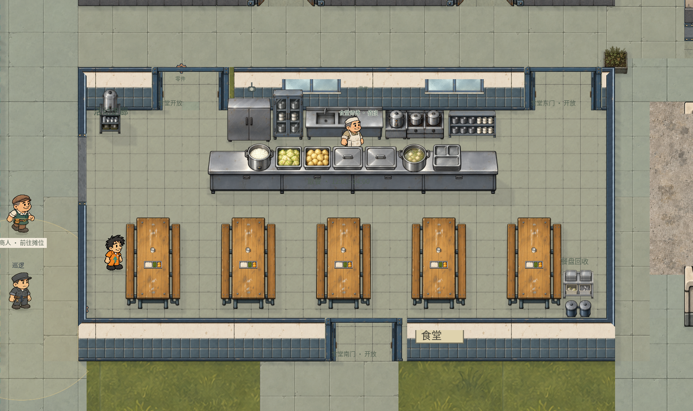

# 食堂概念还原说明

食堂已接入 R04，并同步到你圈出的车间下方现址。室内采用暖白墙面、灰蓝瓷砖、浅暖灰防滑地面、五列木桌长凳；北侧后厨拆成独立柜体、水槽、炉台和餐具架，与工作通道及取餐台分开。西侧保留饮水区，东南侧设餐具回收车和双带盖桶。

## 正式资源

正式资源目录为 E:/Project/Godot/这次怎么逃/art/architecture/cafeteria_v2/，统一注册在 manifest.json。共 43 条定义，包括 27 个墙体瓦片、8 个家具分件、2 个地面及屋顶材质、6 个门组件及状态定义。编辑器支持这些新瓦片和家具的分类、缩略图及放置。

使用内置 image_gen 制作并保留了 7 份原始透明 PNG：wall.png、fridge.png、cupboard.png、sink.png、rack.png、door.png、bins.png。原始图像的 SHA256 与正式资源一致，透明通道保留。完整提示词、来源和用途见 [生产记录](production-assets.json)，注册信息见 [资源注册记录](asset-registration.json)。

纵桌、柜台、餐盘、杯子、饮水桶、回收车、厨师和屋顶板材复用已有美术。炉台从原后厨素材通过注册 region 单独采样，原 PNG 保持完整。

## 空间与连接

正式室内范围为 [900,1940,1200,560]。为了保留东侧维修间及通路，宽度比概念初始预算收窄 160；五组桌凳等比缩小一成，脚印为 126×189，列间净距约 94。家具脚印、图像绘制高度和餐具层级独立标定。

北侧保留两个定时入口，新增南侧定时门和通向原后勤区的铺装连接。用餐时间沿用 12:00–14:00。原 cafeteria-rear 仍位于洗衣房北侧，位置、ID 和时间规则保留，其旧食堂 room_rect 更正为已关联的洗衣房范围；设备间检修门保持原数据。西侧既有开放连接保留。

墙体采用 100 单位完整立面和 20 单位地面接触带。新墙记录 coping_elevation 为 80，屋顶据此与南墙压顶接齐；未配置此属性的旧建筑继续采用原 100 单位压顶偏移。门的关闭和全开两态复用同一框架，仅更换门扇，沿用已修正的门前碰撞和深度排序。

食堂地面、房间显示范围、屋顶、区域标签、取餐点、五组就餐点、厨师位置已统一。旧南墙中属于洗衣房和设备间的共用边界保留其几何与碰撞，并恢复为园区旧墙样式。改造输入、输出及后续校准分别保存在 restoration-input.json、restoration-output.json、refinement-input.json、refinement-output.json，写入前均检查磁盘版本。

## 验证

食堂 native 验收 173 项全部通过，覆盖编辑器地图校验、新资源分类、原 PNG、五组桌间通路、所有取餐和就餐点、厨师工作通道、三个食堂入口的通行与关门阻挡、餐具层级、实际取餐就座、屋顶内外切换及静态绘制缓存。详见 [食堂检查结果](checks.json)。

既有车间门回归 48 项通过。旧场景接缝回归的其余 7 项通过；其“未登记门口”检查在改造前地图与当前地图均报告同一个 campus-workshop-two-south，属于既有问题。改造前后对照分别保存在 roof-regression-baseline.json 与 roof-regression-current.json。

- [游戏室内](runtime-interior.png)
- [游戏屋顶](runtime-roof.png)
- [游戏关门状态](runtime-closed.png)
- [地图编辑器](editor-cafeteria.png)

## 预览入口

open-editor.gd 打开当前正式地图并聚焦食堂，play-cafeteria.gd 在 12:30 打开食堂试玩。当前回归入口 qa/regression_suite.json 已指向 qa/cafeteria_v2.gd。

还原脚本 tools/restore_cafeteria_v2.py 首次接入后会阻止重复改写，避免覆盖后续手工编辑；tools/refine_cafeteria_v2.py 记录此次柜台、厨师和屋顶接缝的校准。

