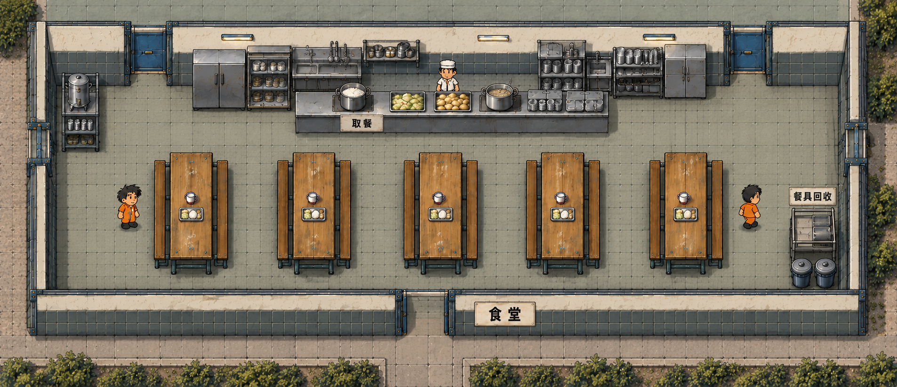

# 食堂重设计美术方案

食堂沿用园区概念中的北侧配餐区和五列南北向长桌，改成边界完整、尺度紧凑的室内。暖白墙面、灰蓝瓷砖、旧木桌和不锈钢厨房形成独立辨识度。改造位置以最新截图圈出的车间下方区域为准，人物继续使用现有统一比例。

## 空间和材质

五组木桌长凳是就餐区主体。每组桌面保持简单，仅摆放独立餐盘和搪瓷杯。北侧厨房分成靠墙设备、工作人员通道、朝南取餐台三层，避免多个设备贴图堆在一起。西侧靠墙饮水，东南侧回收餐具；回收设施不占用入口和桌间走道。

墙面上部采用稍旧的暖白灰泥，下部采用低饱和灰蓝矩形瓷砖；薄深蓝灰金属压顶、墙脚和门框连续连接。地面为浅暖灰防滑小砖，草地只出现在建筑外。正式接入采用 100 世界单位的完整立面，包括 20 单位地面接触带；门框、转角和屋顶按同一高度接齐，避免缩放后成为矮墙。磨损集中于桌沿、把手和墙脚，保持游戏缩放下的轮廓清晰。

厨具使用哑光不锈钢和少量灰蓝柜门。供应米饭、白菜、土豆和清汤，控制为两种开放菜盆；避免丰富自助餐和餐厅装饰。人物、食物、餐具、柜台分别制作，不能烘焙在整张房间背景里。

## 比例和布局预算

采用约 1360×560 世界单位的室内预算，宽度维持五列桌的紧凑排列。以下是用于制作和验证的目标值，不是直接套用到地图的最终坐标。

| 区域 | 建议尺寸 | 布置要求 |
| --- | --- | --- |
| 北侧厨房带 | 深 180 | 靠墙设备脚印深约 60，工作人员净道约 70，取餐台脚印深约 50；左右门口各保留通路 |
| 取餐通道 | 净深 90 | 全宽贯通，排队位置不添加阻挡栏杆 |
| 五组桌凳 | 每组脚印 140×210 | 长轴南北向，沿用已有正确视角的纵桌；五组从西到东排列 |
| 桌间走道 | 净宽约 105 | 四条间隙可实际通行，不依赖缩小人物 |
| 两侧通路 | 各约 120 | 饮水设施靠墙；回收车置于南端侧角 |
| 南侧通路 | 净深约 80 | 连通桌间通道与出口 |
| 取餐台 | 宽 600–720，脚印深 45–60 | 台体、饭菜和餐具为独立分件，面朝南 |
| 饮水和回收设施 | 沿用现有紧凑体积 | 交互位置在设施前方，不能落在脚印内 |

北侧 180、取餐通道 90、桌区 210、南侧通路 80 合计 560。五组桌凳总宽 700、四条间隙总宽 420、两侧通路总宽 240 合计 1360。若新素材脚印超出预算，应调整单件结构；先用人物旁的样板检查比例，再确定房间边界。

概念图中的人物作为比例参照。图中展示北侧两处门和南侧主连接口；准确门洞数量、坐标及西侧、后勤连接以最新地图的门禁关系为准，不能依据概念图删掉原有通路或另增门。

## 美术资源清单

| 优先级 | 资源 | 制作方式及验收要求 |
| --- | --- | --- |
| P0 | 食堂专用墙面和接口 | 制作横墙、侧墙、四角及需要的 T 接头；压顶、瓷砖行和墙脚连续，避免叠压出凸块 |
| P0 | 门框及门状态 | 复用同一套蓝灰金属结构，制作关闭和全开两态；两态框架完全对齐，没有遗留门扇或浮空墙帽 |
| P0 | 室内地面 | 优先复用 cafeteria_v1 的暖灰砖，按概念校准色调和砖格尺度；平铺无明显接缝，室内全覆盖 |
| P1 | 厨房后墙分件 | 把当前整条 backline 拆分为储物柜、餐具柜、水槽备餐台、炉具锅具等独立模块；全套相机方向和高度一致 |
| P1 | 独立服务台 | 优先校准现有空柜台，保留台体和饭菜分离；柜台朝南、可看到台脚，与后墙设备之间有工作人员通道 |
| P1 | 五组桌凳 | 复用 cafeteria_table_vertical_v1，保留 140×210 脚印和木材效果；如需修订先做一组样板，验证后复制 |
| P1 | 饭菜和桌面配饰 | 复用米饭锅、两种菜盆、汤锅、分格餐盘、搪瓷杯，必要时拆分组合素材；保持朴素配给，所有物品完整落在台面 |
| P1 | 饮水和回收 | 复用饮水桶与杯架、回收车、带盖废物桶，核对色调、尺寸和交互位置 |
| P2 | 食堂牌和功能牌 | 分别制作“食堂”“取餐”“餐具回收”，保持小尺寸可读；标牌不参与阻挡 |
| P2 | 窗户及照明 | 复用窄金属窗、简易荧光灯，根据新墙色校准收边；避免窗框与墙角重叠 |
| P2 | 独立屋顶 | 复用食堂暗灰板材方向，补齐与新轮廓一致的包边及短排气罩；确认进入房间时的屋顶切换范围 |
| 复用 | 厨师及食堂角色 | 使用已有 canteen_cook 与囚犯资源，不重新制作医疗人物或其他角色 |

分件资源交付透明 PNG，地面和屋顶纹理交付可平铺不透明 PNG。保留高分辨率源图和生成提示词，并按资源用途分开命名。柜台、桌凳提供空表面版本；人物和阴影不烘焙到地面。

## 地图接入方案

当前 saved R04 的家具已经位于约 y1940–2360 的截图区域，但食堂 visibility_rooms 仍为 [900,2460,1360,560]，就餐点仍位于 y2890，取餐点仍位于 y2710。食堂家具、房间显示范围和活动点需要在同一轮接入中校准，否则会出现地面、屋顶、人物位置各自不一致。

1. 以接入时最新保存的 R04 为基准，核对截图这块区域的墙、门和相邻车间。保留现场布局作为备份，先确定食堂实际边界，避免把已移动的家具搬回旧房间。
2. 先接入墙角、纵桌和柜台三个样板，与现有角色并排检查相机、轮廓高度和脚印；再制作厨房模块和其余墙体。
3. 按 region、ground_rect、footprint_world_size、world_size、elevation_world 注册分件，采用等比缩放。绘制高度与地面碰撞范围分开，餐盘、杯子、灯和牌子不新增阻挡。
4. 一起更新食堂 floor_regions、terrain_patches、walls、architecture、visibility_rooms、zones 及必要的屋顶范围；检查旧位置残留只删除属于此次迁移的食堂数据，保留相邻走廊和其他建筑。
5. 保留 cafeteria-entry、cafeteria-entry-east、cafeteria-rear、maintenance-entry 等既有门禁关系及时间规则；门的位置、视觉状态、碰撞和寻路开口同步调整，西侧开放连接按原功能保留。
6. 同步五组桌对应的 dine 点、meal 点、厨师站位及排队方向。取餐点在柜台南侧，就餐点在桌侧可达位置；厨师在柜台后方工作通道。
7. 加入编辑器食堂分类和真实资源缩略图。静态地面与屋顶沿用缓存，小餐具沿用桌面分件方式，避免增加无用的每帧更新。

沿用现有用餐时间、取餐交互和餐食数值。本轮设计重点为食堂的视觉、比例和空间组织。

## 制作顺序和验收

先确定墙面、角和地面的样板，再完成厨房与柜台分件；桌凳和餐具优先复用。素材在资源预览中检查通过后，再统一接入地图范围和活动点，最后检查室内与屋顶两种显示状态。

- 用截图相同缩放对比：五列长桌、明确厨房层次、连续墙体和统一地面可读，室内没有草地。
- 家具与人物比例成立；五列桌间、两侧和南侧通路实际可达，排队人不会站进柜台。
- 从各既有入口走到取餐点、五组就餐点和回收点；没有地面上看不见的墙、旧位置碰撞或封死的门。
- 门关闭和全开使用同一框架；人物在门前、门后及门柱两侧遮挡正确，开门后不残留旧素材。
- 顶角、墙脚、侧墙与门框连续，窗户和标牌不被错误遮挡，桌面配饰不被桌体覆盖。
- 屋顶轮廓与食堂现址一致，内外切换正常；厨师和就餐角色使用现址的工作及活动点。
- 在地图编辑器和实际游戏窗口各检查一次，相同比例下保持清晰，编辑器缩放和平移无新增卡顿。

## 交付文件

已制作正式 PNG 分件并接入 R04。为保留食堂东侧与维修间之间的通路，实际室内采用 [900,1940,1200,560]；纵桌等比缩小一成，五列布局、配餐层次和两侧功能区保持概念方向。最终资源、门禁关系及实机验证见 [还原说明](README.md)。

- concept-final-v2.png 为整体效果参考。
- reference-current-editor.png 为本轮圈定区域。
- reference-factory-plan.png 为园区原始规划参考。
- layout-evidence.json 记录当前相关数据，接入时仍需重读最新地图。
- generation.json 保存内置 image_gen 的模式、参考图和完整提示词。

