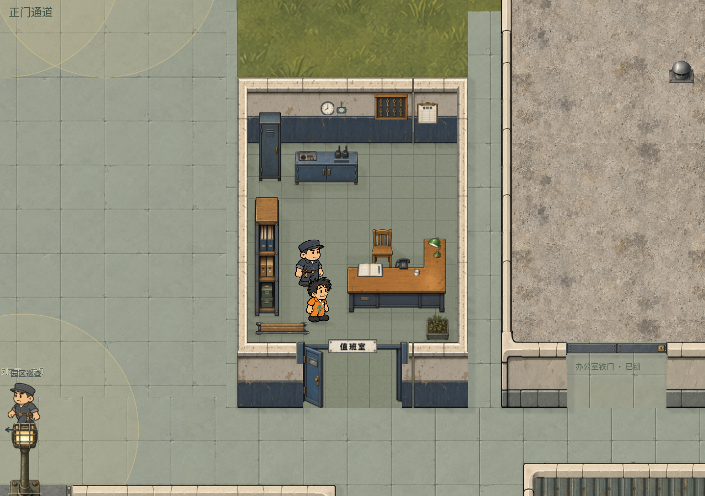
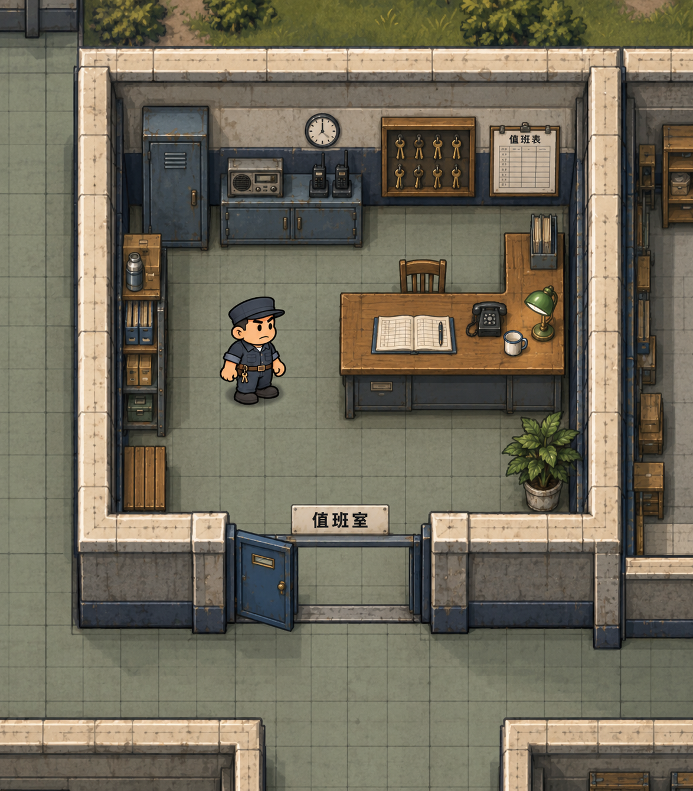

# 值班室美术方案与效果概念图

值班室承担登记、交接班、钥匙保管和门岗通讯。按园区原概念稿，北墙集中布置值班设备，右侧设置 L 形登记台，左侧保留档案收纳和看守站位，南侧入口直通工作区。采用米灰墙面、蓝灰护墙带、旧木台面和暗钢柜体，形成清楚的岗位特征。

已完成独立资源制作、房间缩小和游戏接入。值班室室内范围现为 `[3820,660,380,440]`，南侧入口保留原位置。北墙集中通讯与钥匙区，东侧 L 形登记台、西侧档案架、南侧长凳与绿植已落地，复用现有看守人物及行走帧。

## 已完成的接入

- 内置 imagegen 制作 19 张原始 PNG：15 张家具与附件、地面、墙面、钢门开关两态。源图原样保留，以清单中的有效区域、尺寸与锚点接入；生成提示词和来源见 `generated-assets.json`，哈希及注册结果见 `asset-registration.json`。
- 注册 17 件家具定义（15 件新素材及长凳、绿植两件复用）、27 个建筑定义和一种地面。墙面配套直段、四向转角和门梁，素材可在地图编辑器选择与摆放。
- 北墙向南收拢 200 单位，室内从 380×640 缩至 380×440，面积减少约 31%。释放的北侧区域恢复外围草地。修改以最新保存地图为输入；原始输入和完成地图分别留存为 `last-input-map.json`、`last-output-map.json`。
- 保留原登记台和文件柜的物件 ID 与搜刮类型，新增通讯柜、档案架和钥匙柜。钥匙柜保证包含门钥匙与值班表，支持存入背包和放回。登记簿、电话及无线电小件目前作为场景装饰。
- L 形桌使用两块落地碰撞，凹位可以走入；壁挂钥匙柜设置柜前交互位置。长凳横放在西南墙边，东南绿植向室内收进，避免前墙遮住并保留门口通道。
- 新增值班看守岗位，沿用 `patrol_guard` 的人物外观、八帧行走和 1.4 倍比例，设置室内站位与短巡行路线。屋顶沿用现有管理用房屋面，室内揭顶、室外恢复。

实际主家具尺寸（世界单位，保持源图比例）：

| 家具 | 显示尺寸 | 落地外框 |
| --- | --- | --- |
| L 形登记台 | 180×133.70 | 180×101.61，分两块碰撞 |
| 矮通讯柜 | 115×59.96 | 115×34.78 |
| 蓝灰个人柜 | 40×125.10 | 40×28.77 |
| 纵向档案架 | 45×217.03 | 45×184.47 |
| 木椅 | 38×70.28 | 38×36.55 |

## 验证与试玩

`qa/duty_room_restoration.gd` 实机运行通过 1272 项自动检查，结果见 `checks.json`；其中大部分检查用于确认室外墙体与其他房间、家具、人物数据保持一致。玩法检查覆盖南门整身双向通行、L 形桌凹位、家具碰撞、柜前可达、钥匙柜搜刮、钥匙放入背包和按原格放回、看守巡行及屋顶显隐。另通过地图编辑器 20 项回归和医务室侧滑门 79 项无界面回归。

`runtime-interior.png` 是游戏实际渲染截图。运行 `play-duty-room.gd` 可打开独立试玩窗口，初始位置在值班室内，靠近柜子按 E 搜索；不写入编辑器草稿。入口开放规则沿用原值班室门禁，没有添加新的昼夜日程。

制作入口：`tools/register_duty_room.py`；`--definitions-only` 只更新资源定义，不写地图。资源目录为 `art/props/duty_room_v1/`、`art/architecture/duty_room_v1/`、`art/environment/duty_room_v1/`。

以下保留已批准的概念图与制作前方案，初始建议尺寸以以上实际注册尺寸为准。

## 空间与布局

制作前保存地图的值班室可见范围是 `[3820,460,380,640]`，只有办公桌和文件柜两件主要家具，中央空地及纵深偏大。方案将室内范围收紧至约 **380×440 世界单位**，面积减少约 31%。角色保留已确定的 1.4 倍比例；现有巡逻看守的参考高度是 `62×1.4=86.8` 世界单位。

保留南侧入口和管理用房的前立面，优先将北侧边界向南收拢约 200 单位。建议范围为 `[3820,660,380,440]`，南门仍使用现有 `[3920,1120,180,20]` 的位置与宽度。释放出的北侧区域衔接现有外围草地；西侧主路及相邻办公室、监控室的布局按最新保存草稿保留。概念图表达物件关系与材质，实际坐标在接入时按最新草稿校准。

| 区域 | 布置与用途 |
| --- | --- |
| 北墙左侧 | 蓝灰钢制个人柜，柜顶高于人头；侧边留出柜门操作位置 |
| 北墙中部 | 矮通讯柜，上放旧式无线电及对讲机充电座；墙上挂时钟 |
| 北墙右侧 | 浅壁挂钥匙柜和值班表，保持钥匙形状和交接记录可辨认 |
| 东侧中部 | L 形木面登记台，转角靠东墙；电话、登记簿、台灯与茶杯分开摆放 |
| 西侧 | 朝室内开放的窄档案架，文件夹和少量日用品沿墙收纳 |
| 中央偏左 | 看守完整站姿和巡行空间，可接近登记台、通讯柜及钥匙柜 |
| 西南与东南 | 小长凳与一盆绿植各靠边布置，入口与中央通道留空 |
| 南侧入口 | 蓝灰手动钢门、小观察窗和米白名称牌；开门后门扇停在通道侧边 |

入口到登记台、北墙操作点的连续通道建议净宽至少 100 世界单位。桌子的内转角保留真实凹位，椅子收在工作台后方，不用碰撞矩形封住整个 L 形空缺。

## 资源制作清单

下表尺寸用于首版校准，单位为世界单位。家具渲染尺寸包括正面高度，落地占位只包含接触地面的部分，两者分别登记。最终保留原图比例，以人物并排和游戏镜头检查为准。

| 资源 | 制作方式 | 初始尺寸与要求 |
| --- | --- | --- |
| L 形登记台 | 新制主资产 | 显示约 180×155；落地外框约 180×115，用两块矩形描述 L 形占位；旧木台面、钢制抽屉，台面小件不烘焙进主体 |
| 矮通讯柜 | 新制主资产 | 显示约 115×85，落地约 115×45；柜顶接近腰部，正面双柜门可辨认 |
| 蓝灰个人柜 | 新制主资产 | 显示约 55×120，落地约 55×30；单门、通风槽、黄铜拉手，避免复用比例过高的旧文件柜 |
| 纵向档案架 | 新制主资产 | 显示约 45×245，落地约 45×200；面向室内的专用纵向视角，文件夹收在架内 |
| 登记台木椅 | 新制配套 | 显示约 38×65，落地约 38×35；椅背不遮住桌上的关键物件 |
| 电话、登记簿、台灯、茶杯 | 四张独立台面小件 | 电话与登记簿优先清晰轮廓；台灯如需亮灯，发光另做运行时效果，原图不带大范围光晕 |
| 旧式无线电、对讲机充电座 | 两张独立台面小件 | 通讯柜专用；保留旋钮、扬声器和两台对讲机的辨识特征 |
| 壁挂钥匙柜 | 新制壁挂件 | 约 65×65；浅木框、暗底、少量大钥匙；柜体与可获得的钥匙物品分别处理 |
| 值班表、时钟、名称牌 | 三张独立壁挂件 | 值班表约 45×60、时钟直径约 25；名称牌只写“值班室”，大字清楚，小字不作为可读信息依赖 |
| 蓝灰护墙带与门框附件 | 新制建筑表面及附件 | 复用现有墙体轮廓和米白压顶，补横向、纵向护墙带及端部收口；转角接缝与原墙对齐 |
| 值班钢门 | 新制开关两态 | 门洞宽 180，门扇、门框、门梁和门槛分别描述；开关图使用相同尺寸和锚点，门扇停止位置避开主通道 |
| 灰绿小方砖 | 新制无缝地面 | 较细砖格、少量裂纹和污迹；墙边与门槛保持同一平铺起点，不用噪点铺满表面 |
| 西南长凳 | 优先复用 | 校准现有 `yard_bench_vertical_v54` 的纵向素材，保持原比例，先试长约 100；如靠背和材质明显不匹配再单独制作 |
| 东南绿植 | 优先复用 | 复用 `weed_planter_v44` 等现有园区绿植，控制占地，避开出入口 |
| 值班看守 | 复用现有人物 | `patrol_guard` 已有站立和八帧行走；本轮不重新绘制人物，室内岗位与现有巡逻规则在接入时单独绑定 |

优先制作登记台、通讯柜、个人柜、档案架及地砖，先核对房间密度。第二批加入钥匙柜、通讯与登记小件；最后补椅子、标牌、时钟、门和墙面收口。

## 画面与交付规格

沿用游戏固定斜俯视，水平和竖直边与屏幕对齐，家具顶面和立面使用一致角度。木面采用暖棕色，钢柜用蓝灰色，墙面用米灰色；把手、钥匙和电话轮廓清楚，磨损主要放在边缘、抽屉口和经常触碰的位置。柜子、护墙带与桌面区分明暗层次，控制沙粒和模糊纹理。

家具及小件交付独立 RGBA PNG，透明边缘干净，保留原始生成文件。主家具建议以 1024 像素级原图制作，纵向架子按长画幅绘制；地砖交付无缝平铺图。每件登记有效区域、显示尺寸、落地面积、脚底锚点、方向与碰撞方式。阴影由场景统一处理，原图只保留物件内部明暗。

家具、门扇和人物按落地点排序，头与身体共用一套排序。壁挂件依附墙面，门槛留在地面层；门扇和门梁分开处理。屋顶复用园区管理用房的灰蓝屋面与收边，保持室内显隐规则。

## 原定接入步骤（已执行）

1. 从效果图拆出独立资产，登记家具、地面和附件清单，在编辑器中增加中文分类与缩略图。
2. 以制作人最新保存的地图为输入，收紧值班室边界，同步墙体、房间可见范围、地砖、门梁及背景草地。南侧门位、主路和邻室按草稿保留。
3. 替换 `campus-admin-desk-0` 和 `campus-admin-cabinet-0` 的外观与占位，延续已有 `office` 搜刮类型；新增档案架与钥匙柜按内容单独配置掉落。
4. 登记台采用 L 形落地碰撞，装饰小件附在台面；看守岗位设置柜前与桌旁操作点，避免站在门扇、椅子或高柜后。
5. 检查南门双向通行、开关两态与整身碰撞，再检查柜前操作距离、搜刮、背包拖入和放回。门禁开放规则在玩法阶段定义，不套用医务室时间。
6. 在游戏正常镜头、室内揭顶状态、室外屋顶状态和编辑器缩放下复核体量、接缝和遮挡。保存并重开地图，确认资源和岗位保持一致。

钥匙柜现已接入钥匙与值班表搜刮。登记簿的交接班信息、无线电通讯或巡逻调度仍作为后续玩法接口，本轮完成场景美术与空间布置。

## 验收要求

- 常用镜头可辨认北墙通讯与钥匙区、东侧 L 形登记台、西侧档案架和中央看守，与原地图概念的物件关系一致。
- 看守保持 1.4 倍；桌面接近腰部，矮柜、高柜、架子的高度有明显区别，房间不再像空走廊。
- 入口到登记台及北墙操作点连续可达，桌角、椅子和开门门扇不堵住路径。
- 人物走过门槛不会消失，经过家具前后时整个人物一起排序；无虚空碰撞和穿墙小件。
- 地砖无明显拼缝，压顶与护墙带转角连续，透明轮廓清楚，没有密集砂噪和重复大阴影。
- 旧柜的搜刮内容与存取行为保留，新增家具能在编辑器选择、移动、旋转及保存重开。

## 文件与来源

批准的效果概念图为 `concept-v1.png`，由内置 imagegen 使用两张用户参考图和现有看守素材生成。完整提示词、模式、来源路径见 `concept-v1.prompts.json`。项目副本原样保留生成 PNG，哈希与尺寸见 `design-record.json`。19 张游戏资源的逐张提示词与来源见 `generated-assets.json`。

两张用户参考图保存在 `references/map-concept.png` 与 `references/editor-current.png`。游戏接入以实际保存地图为准，局部修改记录与输入、输出哈希见 `map-registration.json`。
