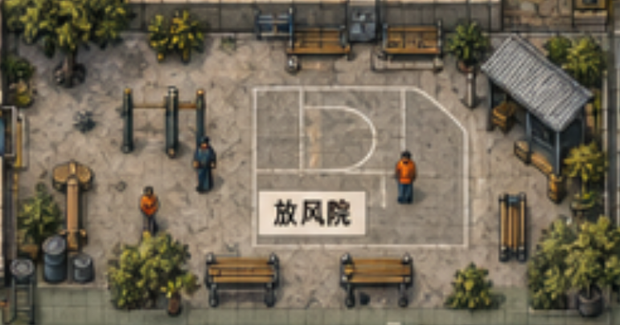

# 放风院美术制作需求与实施方案

放风院需要恢复为概念图中的露天活动区：浅灰土色的旧水泥地面、中央简易半场、西侧健身器材、东北角遮雨棚，以及沿边布置的长椅和绿化。先修正空间边界与地面，再制作缺少的器材和环境素材。首版验收重点是整体构图、室外感和人物尺度。

本方案服务于场景美术制作与地图装配。2026-10-12 已完成首版装配：撤去独立院墙，替换室外水泥地面，加入单杠、分层遮雨棚、五张长椅和七组主体盆树。随后按用户反馈补充右侧过渡：三组盆树、八组低矮灌木、积土和零散草边，上下形成种植小组，中央保留主通道入口；水泥接缝的柔化宽度从 28 调整到 56 逻辑单位。参考图的相对位置和视觉关系优先于插画中的细节像素；下文的通道尺寸作为制作目标，通过引擎摆放与实际通行复核。

## 参考范围与空间边界

主要参考为用户提供的放风院近景；总地图用于确认相邻建筑、主通道和园区边界。总地图红框位于西南杂物区，该区域不计入本次放风院改造。

放风院本身不单独围起四面的院墙。北侧借园区外围墙与树带形成背景，西侧衔接医务室及其周边步道，南侧连向车间前步道，东侧连向正门主通道。外围安全墙、医务室建筑墙和车间建筑墙继续承担各自的边界功能；院子内部用材质、绿化、座椅和活动设施划分区域。

现地图的放风院活动区域约为 900 × 800 逻辑单位，位置约为 x 2300 至 3200、y 340 至 1140。首版沿用这一活动区位置，调整内部构图和开放边缘，避免带动全图建筑搬迁。北侧与外围墙之间的现有空隙作为树带和连接地面处理。

## 当前偏差与修正目标

| 当前表现 | 对照概念的偏差 | 修正目标 |
| --- | --- | --- |
| 独立四边墙体和三个门洞 | 院子呈现房间形态，步道连接受门洞限制 | 撤去独立院墙及其门洞表现，形成露天场地的开放边缘 |
| 灰绿色规则大方砖 | 与室内通用地面相似，缺少室外旧水泥质感 | 改为浅灰褐旧水泥，局部裂缝、补丁与灰尘沉积 |
| 大片规整球场线和中圈 | 球场主导场景，缺少放风院的多种活动区域 | 改为中央简易半场，外围留健身、休息和通行空间 |
| 篮球架、三张长椅、四个方形花盆 | 器材和摆放层次不足 | 补单杠组合、遮雨棚、成组绿化及少量生活痕迹 |
| 物件零散且距离大 | 缺少边缘聚集与中央留空的构图 | 北侧、东北角和南侧形成物件组，中央保持可读的活动空地 |

当前方砖来自放风院的独立地面配置，不能通过替换室内公共地砖一并处理。长椅和篮球架已有素材，可先复用；中央花园的整块树岛属于其他区域，不应直接搬来占满放风院。

## 目标布局

| 方位 | 主体布置 | 装配要求 |
| --- | --- | --- |
| 北侧 | 树带、两张旧木长椅、少量桶盆 | 借外围墙形成背景，树木和椅子成组，椅前留站立及通行空间 |
| 西侧 | 简易单杠组合、邻近的小器材区 | 不堵医务室周边步道；竖杆、横杆与地面接触阴影清楚 |
| 中央偏东 | 一个简易篮球半场、一座篮球架 | 球场约占活动区面积的 20% 至 30%；篮架位于端线外，不站在场内中心 |
| 东北角 | 波纹铁皮遮雨棚、棚下长椅或小储物箱 | 棚体成为次要视觉焦点；立柱与顶棚分层，棚下人物可辨认 |
| 南侧 | 两张长椅、树盆和入口缓冲空地 | 与车间前步道自然衔接，保留主要进出路径 |
| 东侧 | 沿边座椅或小绿植组 | 向正门主通道开放，物件不能挤占主通道 |

整体保持“边缘丰富、中央疏朗”。先以地面、半场、单杠、遮雨棚和长椅确定五个主要形状，再加入绿化与小物。空间不能平均撒满盆栽，也不能用高密度碎石填补所有空地。

南侧和东侧主要连接口暂按 140 至 180 逻辑单位以上的通行宽度预留；器材与长椅之间的次要通路暂按至少 96 逻辑单位预留。该尺寸用于摆放初稿，后续以真实角色碰撞、NPC 会车和寻路验证为准。

## 素材制作清单

| 素材组 | 首版素材交付 | 场景用量目标 | 制作与复用方式 | 优先级 |
| --- | --- | --- | --- | --- |
| 室外旧水泥 | 1 张可平铺底纹，2 至 3 个裂缝或修补贴花 | 覆盖活动地面，贴花稀疏点缀 | 新制灰褐低噪点底纹，避免室内方砖和大块重复裂纹 | 必做 |
| 边缘过渡 | 泥尘、碎石、杂草过渡各 1 至 2 种 | 分段用于开放边缘与物件根部 | 透明贴花或现有地形模块组合，打散矩形地面的硬边 | 必做 |
| 球场标线 | 1 套磨损半场线，含边线、罚球区与弧线 | 1 处 | 分离于底纹，保留编辑位置和尺寸的能力；移除现有完整中圈布局 | 必做 |
| 单杠组合 | 1 个组合主体，立柱与横杆可拆分 | 1 组 | 新制旧深绿金属与少量锈迹；预留杆旁站立点 | 必做 |
| 遮雨棚 | 顶棚、后侧结构、前侧立柱三部分 | 1 座 | 新制灰蓝波纹铁皮与旧木或金属立柱，棚下留空 | 必做 |
| 长椅 | 横向和纵向两种朝向 | 4 至 5 张 | 先复用现有长椅；需要其他朝向时重画，避免旋转贴图导致透视错误 | 必做 |
| 篮球架 | 1 个现有架体的适配版本 | 1 座 | 复用现有素材，先校准位置和比例，必要时调整底座及锈蚀 | 必做 |
| 绿化 | 2 种树形、2 种灌木形、1 至 2 种盆或基座 | 5 至 7 组边缘绿化 | 可复用现有单株与盆栽素材；补足不同高度，避免四个同款方盆均匀摆放 | 必做 |
| 生活小物 | 水桶、旧油桶、小木箱各 1 种 | 合计 3 至 5 件 | 优先复用现有道具，集中于棚下和边缘，中央不散放 | 第二批 |
| 场景标识 | 小型放风院标牌或地面名称 1 处 | 1 处 | 正式文字由引擎字体绘制，参考图的白色大标签不作为实体物件 | 第二批 |

新制重点集中在地面、过渡、单杠和遮雨棚。复用素材在同一场景中经过尺度、色调和阴影复核后再入场。树叶、裂缝和小杂物的变体用于打散重复，不增加无关设施。

## 画面风格与比例

保持现有游戏的俯视手绘视角、横纵轴建筑布局和角色画风。树冠、器材顶面及椅面体现俯视关系；侧面高度服从现有场景投影，避免混入等距菱形地面或正面摄影器材。

主色为浅灰褐水泥、灰绿金属、旧木棕与低饱和橄榄绿。地面亮度低于米白 HUD，但略高于深色器材；叶片保留成组明暗，纹理在正常游玩尺寸下保持清楚。锈迹、磨损和裂纹集中在边缘与接触位置，避免整张素材覆盖均匀砂点。

角色沿用当前 1.4 倍显示设置。工程家具尺度以 96 逻辑单位的既有美术标尺校准，首版复用长椅的约 160 单位宽度与篮板约 120 单位宽度作为摆放起点；树冠大小、单杠高度和棚体尺寸需与当前实机人物一起复核。不能为适应新道具再缩放角色，也不能把有高度的物品压扁来匹配地面。

长椅支脚、篮球架底座、树盆和棚柱有明确的接地位置。阴影延续场景既有方向与柔边，优先使用统一渲染层；素材如自带阴影，须记录并关闭重复的引擎投影。

## 引擎交付与性能要求

每个新道具交付透明 PNG 原图和资产记录，保持真实透明通道与源图纵横比。记录纹理区域、世界显示尺寸、接地矩形、显示高度、脚底锚点、排序位置、阴影方式与碰撞形状。顶棚与前柱分开交付，以便按人物脚部位置处理遮挡。

地面与球场线独立交付，地面支持平铺，标线支持编辑尺寸和位置。树冠、杆体顶端和棚顶属于显示范围；碰撞只作用于树干、基座、立柱及实际阻挡区域。花叶和阴影不能变成隐形大碰撞。

撤去独立院墙时同步处理墙体显示、墙影、碰撞、视线阻挡和门洞登记，避免出现可见墙已经消失但仍无法通过的情况。保留医务室、车间与园区外围的真实结构边界。沿用放风院区域和 NPC 活动点的现有标识，调整点位时核对日程及寻路引用。

原始 PNG 保持完整尺寸，裁剪区域后为运行时纹理设置上限：小道具、棚体和盆树使用 512 像素，地面底纹使用 1024 像素。使用 mipmap，保留静态地面与阴影缓存；细碎地面痕迹使用贴花或图集区域，避免为每块碎石创建独立更新节点。

本轮美术装配不承诺新增篮球、健身或坐椅玩法。制作资产时预留交互点和站立点，后续玩法接入仍使用现有交互提示体系。

## 制作顺序与交付

1. **空间与地面初稿。** 用现有素材撤去独立院墙表现，确定开放边缘、通路、半场比例和器材占位。交付总览及人物视角截图，先确认院子形态。
2. **主要素材。** 制作旧水泥、地面过渡、单杠及遮雨棚，完成长椅和篮球架适配。新素材先在同一光照、同一人物标尺下排成接触表复核，再放入地图。
3. **场景组合。** 完成北侧背景、东北棚区和南侧休息区，加入树盆、灌木及少量生活小物。交付不带 HUD 的场景总览和正常 HUD 游玩截图。
4. **实机验证。** 检查三种窗口尺寸、通路、遮挡、碰撞、NPC 活动点及性能。修正后交付资产清单、地图改动记录和概念对照截图。

## 验收条件

- 放风院能一眼被识别为露天活动区，南侧和东侧向步道开放，外围安全边界仍完整。
- 浅灰褐水泥、中央半场、西侧单杠、东北遮雨棚、南侧长椅等主要构图与参考一致。
- 中央保留活动空间，球场不占满院子，绿化与小物沿边成组。
- 树、棚、长椅与人物尺度统一，接地清楚，纹理清晰，没有整片模糊砂点。
- 人物可从连接步道进入并绕行所有设施；地图边缘、建筑墙和真实阻挡物没有穿越漏洞。
- 棚下人物、单杠后方人物和树盆附近人物的遮挡与碰撞合理，旧院墙不残留隐形碰撞或墙影。
- 在 960 × 540、1200 × 720、1440 × 900 截图中复核场景与 HUD；以相同窗口、镜头和画质对比改造前后的内存、帧时间及绘制提交数，记录实际变化。

## 参考与现状资料

近景参考：[reference-closeup.png](reference-closeup.png)。总地图参考：[reference-map.png](reference-map.png)。当前实机：[current-runtime.png](current-runtime.png)。现状数据记录：[source-inventory.json](source-inventory.json)。

实施入口为 `data/rooms/r04.json` 中放风院边界、地面、器材和活动点。新增素材原图保存在 `art/props/exercise_yard_v54/` 和 `art/environment/exercise_yard_v54/`，使用内置 imagegen 生成；最终提示词见 [production-prompts.txt](production-prompts.txt)。装配脚本为 `tools/build_exercise_yard.py`，资源区域、尺度和运行时纹理上限记录在两份 `manifest.json` 中。

实机总览与三种窗口截图见 `docs/dev/p139/`；碰撞、寻路、编辑器素材登记及缓存检查见同目录的 `headless-checks.json` 和 `native-checks.json`。静态场景性能采样见 `baseline.json` 与 `performance.json`，它不代表完整七天 NPC 模拟的性能。
