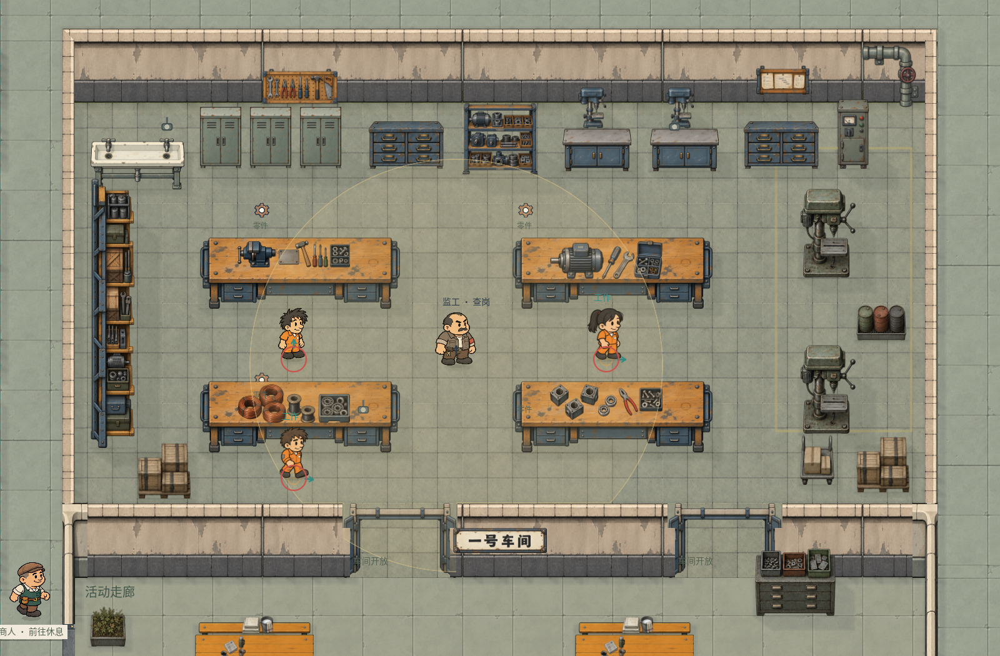
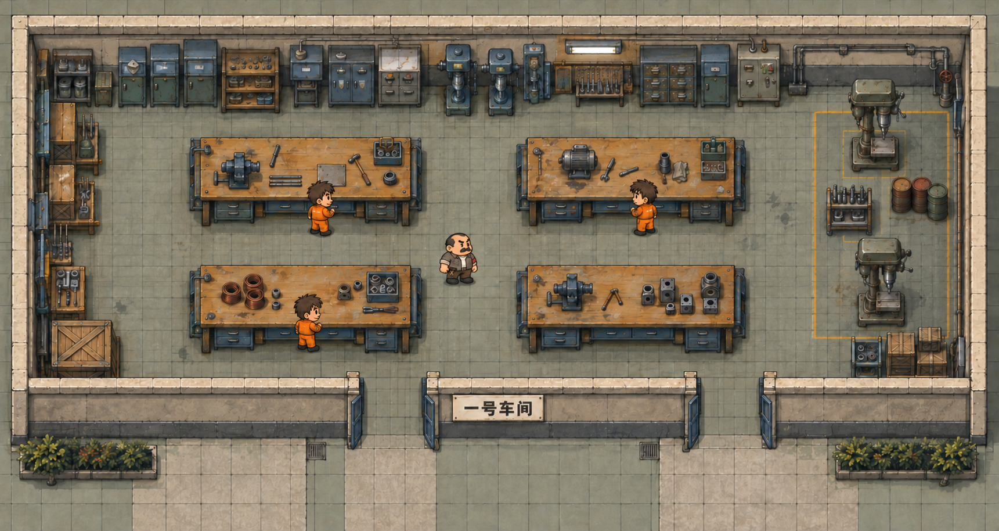

# 一号车间美术方案与效果概念图

最新完成情况和实机图见 [一号车间空间与摆件修订交付](delivery-v2.md)，对应 [美术修订需求](requirements-v2.md)。房间已收至 1200×600，北墙与西墙设备带已重做。以下完成情况和测试结果为上一版接入记录。

一号车间以手工装配、零件整理和小型钻加工为主要视觉内容。恢复园区原概念稿的四组中央工作台与沿墙设备带，采用暖木台面、蓝灰钢制柜体、米灰旧墙和灰绿色工业地砖。工作台有清楚的体量与工序区别，工具和机器集中在边缘，中央保留监工巡行及工人通道。

## 已完成的游戏接入

已制作并接入 18 张独立源 PNG，原始图片保留完整字节和透明通道；通过资源清单校准有效区域、显示比例和落地范围。19 件家具定义包含 14 件新家具与附件及 5 件复用设备，另注册 27 个建筑定义和一种地面。四张工作台共用空台体，钳工、电机、绕线和壳体小件分别显示。

室内范围保持 1360×720，南门与东门的原始门位及关联规则保持一致。沿墙柜架已集中，原工具柜、零件柜和物资箱的 ID 与搜刮类型保留；新增沿墙柜架和西南物资箱可搜索。底排工作点收至 `[1170,2000]`，监工下方巡行点收至 `y=2000`，避开南墙完整可见范围的碰撞。南侧看起来属于室内范围的墙面投影也占据实际碰撞，不能将工作点放在墙面上。

东门外原活动桌的右边缘紧贴门口直行线，已将该桌及其台面小件整体向左移动约 49 单位；其他走廊家具保持原布局。西南物资箱保留侧面可达的搜索位置，东南箱和推车移到南墙内侧。地图注册脚本每次基于最新保存文件局部更新并检查哈希，输入、输出快照见 `last-input-map.json`、`last-output-map.json`，首次接入前地图另留在 `initial-input-map.json`。

实际工作台显示尺寸为 **320×113.95**，落地尺寸为 **320×88.88**；按原始图比例注册，未拉长图片。纵向架显示约 70×430.75、落地约 70×361.83，其长度沿西墙铺开；电控柜校准到宽 50、显示高约 111.21。以下制作前尺寸作为设计意图保留，实际尺寸以各素材清单为准。

车间门使用开、关两态钢门图，门槛仍在地面层，中央开口整身可通行。门禁由原 `WorkshopRules` 驱动，劳动时两门关闭、午休开放；工资和到岗监督仍使用现有规则。沿用监工和工人人物，保持 1.4 倍比例，更新三处工作点及监工路线。屋顶沿用原园区屋面，入室揭顶、室外恢复。

`qa/workshop_one_restoration.gd` 实机通过 **155 项自动检查**，包含源图哈希、地图局部修改、两个门的双向整身通行与门外直行路线、工作点可达、柜前可达、物品放入背包和放回、实际监工巡行、劳动门禁、屋顶显隐及编辑器素材注册。结果见 `checks.json`。试玩入口为 `play-workshop-one.gd`，靠近柜子按 E 搜索。

地图编辑器另通过 **20 项回归检查**，结果见 `editor-regression.log`。

独立素材位于 `art/props/workshop_one_v1/`、`art/environment/workshop_one_v1/`、`art/architecture/workshop_one_v1/`。完整提示词和生成来源见 `generated-assets.json`，有效区域与原图哈希见 `asset-registration.json`；接入脚本为 `tools/register_workshop_one.py`，`--definitions-only` 只更新资源定义。素材也已进入地图编辑器的家具、墙体及门分类。

## 布局与比例

当前保存地图的一号车间室内范围为 `[820,1420,1360,720]`。四张工作台各宽 190、落地深约 73.89，台面内容主要是工具和电机两类。三只工具柜散落在中右部，北墙设备带较少；四张台子占地偏小，周围空地缺少生产区的使用痕迹。

制作方案保留 1360×720 的室内范围和两处南门，通过增大工作台、把工具柜移至北墙、增加有用途的沿墙家具来恢复概念图密度。角色继续使用已确定的 1.4 倍比例。工作台方案按宽 320、落地深 120 试摆，相比原有 190 宽增加约 68%，约为 86.8 高参考角色的 3.7 倍宽；实际接入时按独立源图比例校准了显示高度和落地深度。

| 位置 | 布置 | 视觉与通行要求 |
| --- | --- | --- |
| 中央偏西 | 四组大工作台，两行两列 | 台体统一，四种台面工序有明显区别；桌前留工人站位 |
| 北墙 | 工具柜、抽屉零件柜、开放零件架、小台钻和电控柜 | 高低错落，有连续设备带；高柜不落在中央通道 |
| 西墙 | 向室内开放的窄零件架与工具收纳台 | 使用专用纵向视角；西南物资箱靠角摆放 |
| 东墙 | 两台立式钻床，中间短架和油桶 | 用少量旧黄线标出机器区；操作面朝室内 |
| 东南 | 物资箱与小推车 | 物资箱可搜刮，推车不占东门路线 |
| 中央通道 | 监工巡行和工人往返 | 主纵向通道约 180，工作台两排之间约 110 |
| 南侧 | 两处蓝灰钢门及名称牌 | 室内前墙一带保持约 120 的连续通道，门扇打开后留在侧边 |

图中台面与设备用于表达材质、组合和体量，精确摆放以落地范围校准。概念图不作为整张贴图铺进地图。

## 地图摆放草案

以下坐标相对于室内左上角 `[820,1420]`，单位为世界单位，矩形表示落地外框。接入时使用最新保存地图，重新验证人物整身通行和工作点。

| 对象 | 相对落地矩形 | 对应旧对象或用途 |
| --- | --- | --- |
| 左上工作台 | `[200,220,320,120]` | 保留 `bench_0` |
| 右上工作台 | `[700,220,320,120]` | 保留 `bench_1` |
| 左下工作台 | `[200,450,320,120]` | 保留 `bench_2` |
| 右下工作台 | `[700,450,320,120]` | 保留 `bench_3` |
| 北墙柜架带 | 约 `x=20…1100, y=20…100` | 将原三只工具柜集中，并穿插低柜、零件架 |
| 西墙架台带 | 约 `x=20…95, y=170…500` | 纵向架台，不侵占西侧操作通道 |
| 上方立式钻床 | `[1160,160,90,90]` | 原立式钻床校准并复用 |
| 下方立式钻床 | `[1160,400,90,90]` | 原立式钻床校准并复用 |
| 油桶组 | `[1250,280,80,55]` | 靠东墙、在两钻床之间 |
| 东南箱与推车 | 约 `x=1160…1330, y=550…600` | 不占东门前方，尺寸按源图拆分 |

两处门禁仍为 `[1260,2140,160,20]` 和 `[1780,2140,160,20]`，中心约在室内宽度的 38% 与 76%。保留主门和东门的关联关系。

三名劳动角色的候选工作点为相对 `[350,390]`、`[850,390]`、`[350,620]`。监工候选初始点为 `[610,400]`，沿台间通道、东侧机器区和南侧通道巡行。接入时更新 `routine_points.work` 与 `workshop.patrol`，不能只移动桌子而保留旧工位坐标。

## 独立美术资源需求

新增资源按 **18 张独立源 PNG** 规划。一个台体复用四次，台面四套小件独立显示；柜架和建筑表面分别注册，避免把机器、小件和大阴影烘焙成一张不可调整的整室图。

| 资源 | 数量 | 初始显示及落地要求 | 优先级 |
| --- | --- | --- | --- |
| 重型木面工作台 | 1 | 显示约 320×180，落地 320×120；蓝灰钢架、抽屉和明确桌腿，桌面留空供小件组合 | 第一批 |
| 钳工台面组合 | 1 | 显示约 180×75；虎钳、手锤、金属板与少量刀具，接触桌面，无独立地面碰撞 | 第二批 |
| 电机装配组合 | 1 | 显示约 180×85；小电机、工具盒、螺丝刀和螺母 | 第二批 |
| 绕线台面组合 | 1 | 显示约 180×75；铜线卷、线轴和零件托盘 | 第二批 |
| 壳体整理组合 | 1 | 显示约 180×75；金属壳体、夹具与成品小盒 | 第二批 |
| 零件抽屉柜 | 1 | 显示约 120×100，落地约 120×45；抽屉把手清楚，标签只表达材质 | 第一批 |
| 北墙开放零件架 | 1 | 显示约 120×125，落地约 120×45；电机壳、轴件和少量箱子分层收纳 | 第一批 |
| 西墙纵向零件架 | 1 | 显示约 70×220，落地约 70×180；独立纵向视角，开口朝室内 | 第一批 |
| 矮工具柜 | 1 | 显示约 110×80，落地约 110×40；承担低台及柜顶设备支撑 | 第二批 |
| 小型台钻 | 1 | 显示约 45×90；安放在沿墙台体上，区别于落地钻床 | 第二批 |
| 壁挂工具板 | 1 | 显示约 120×70；少量轮廓清楚的扳手、钳子和锤子，不铺满细碎工具 | 第二批 |
| 电气控制柜 | 1 | 显示约 70×110，落地约 70×30；简洁按钮、仪表和走线接口 | 第二批 |
| 班次与生产记录板 | 1 | 显示约 85×65；纸张、夹具和框架可辨，小字不承担可读信息 | 第三批 |
| 一号车间名称牌 | 1 | 显示约 150×35；只写“一号车间”，字形清楚 | 第三批 |
| 工业小方砖地面 | 1 | 无缝基础地面，砖格约 40；油污、裂纹和机床印痕另做局部叠层 | 第一批 |
| 车间墙体表面 | 1 | 米白压顶、米灰抹灰、深灰粗砖墙脚；可采样直段、端部、转角和门梁 | 第一批 |
| 钢门打开状态 | 1 | 同一 160 宽门洞，门框与门扇分别描述，打开后中央为连续可见地面 | 第三批 |
| 钢门关闭状态 | 1 | 与开态使用同尺寸、锚点及落地点；关闭碰撞覆盖门洞 | 第三批 |

长架不能把横向柜图简单旋转后拉伸。墙体四个转角需要连续压顶、45 度收口与墙脚对齐；门梁、门扇、门槛分别分层。PNG 的透明外沿应干净，保留原始生成文件，通过清单记录有效区域、显示尺寸、落地面积与脚底锚点。

## 可复用资源

| 现有资源 | 使用方式 |
| --- | --- |
| `tool_locker_v42` | 北墙高工具柜，按角色并排校准宽度与高度，不拉伸源图 |
| `drill_press_v44` | 东侧两台落地钻床，先用约 90×90 落地范围试摆 |
| `oil_drums_v44` | 东侧油桶组，颜色保持低饱和，局部油污放在地面叠层 |
| `shipping_crates_v44`、`parcel_trolley_v44` | 西南与东南物资，校准体量并留出南门路线 |
| `pipe_valve`、`wall_vent`、`caged_wall_lamp` | 沿墙管线、通风和照明；壁挂深度独立于地面碰撞 |
| `overseer` | 现有灰褐服装、红袖章、胡子监工，保留人物及行走资源 |
| `young_worker` 等现有工人 | 复用橙衣人物，不为本次场景重新制作角色 |

## 材质与建筑风格

一号车间使用旧工业建筑的粗砖墙脚和抹灰墙面，柜体为蓝灰与暗钢色，台面使用偏蜜棕的磨损木材。与医务室的绿色瓷砖、行政房间的平整护墙板形成区别。磨损集中在台沿、把手、抽屉口和机器底座；台间地面保持安静，避免整面砂噪、过度生锈和灰糊滤镜。

沿用固定斜俯视与屏幕对齐的横竖建筑轴线。家具顶面和立面的角度一致，人物脚下接触阴影轻，家具不绘制大面积长阴影。黄色警戒线只标机器区。灯光先作为环境照明，发光另由运行时效果控制。

屋顶沿用现有园区工业屋面及房间显隐方式，室外覆盖、进入揭顶。首轮重点是室内密度及家具体量；如现有屋面与新墙框不匹配，再补同边界的顶面和收边，不改变建筑占地。

## 玩法与接入方案

保留劳动工时、工资、到岗和擅离岗位的现有规则，车间门禁仍由 `WorkshopRules` 决定。概念图表现开门状态；新门图需要同时支持现有劳动时段的关门状态，不能套用医务室开门日程。

现有 `locker_0…2`、零件柜、物资箱的对象 ID 和搜刮内容继续保留。工具柜使用 `tools`，零件柜使用 `industrial`，物资箱使用 `warehouse`。台面装饰不全部变成独立搜刮点；可拾取工具、绕线、装配等玩法留作后续扩展。本轮首先确定场景美术与空间关系。

1. 制作第一批台体、柜架、地面和墙面，注册到 `art/props/workshop_one_v1/`、`art/environment/workshop_one_v1/`、`art/architecture/workshop_one_v1/`，先与人物并排核对体量。
2. 从最新保存的 R04 地图局部更新一号车间。保留外墙边界、南门、相邻建筑及活动走廊，只替换目标家具与表面，并留存输入快照。
3. 将四张工作台和北墙柜架布置到目标位置，台面小件附在各自桌面层。搬移旧工具柜、钻床和物资后同步更新劳动点与监工巡行点。
4. 追加工具板、班次板、管线和灯具；壁挂资源设置可达的柜前交互位置。家具碰撞只使用落地范围，人物头与身体共同按落地点排序。
5. 换上开关两态门图，检查门禁关联、整身双向通行、门槛分层与关闭碰撞，再核对屋顶遮挡。
6. 在正常游戏镜头和编辑器缩放下检查密度与清晰度，验证柜子搜刮、背包拖入与放回、劳动及监工巡行，保存重开地图。

## 验收要求

- 四组工作台一眼可辨，台面对应四种作业内容，北墙形成设备带，东侧保留两台立式钻床。
- 工作台、柜架、机器与 1.4 倍人物协调；缩放到常用镜头后仍能认出工具和柜门，地面不掩盖道具轮廓。
- 两处南门、主纵向通道、横向台间通道及所有劳动点可达，巡行不穿桌、撞柜或经过机床实体。
- 门开时中央通道完整可见，关闭时整身检测一致；人物头和身体共同排序，没有门槛盖人或虚空格挡。
- 原搜刮柜与物资箱能存取物品，工时和门禁仍由原规则驱动，其他房间及走廊数据保持一致。
- 家具可在编辑器中选择、移动、旋转及保存重开；墙角接缝和地面拼缝在放大后连续。

## 文件与来源

`concept-v1.png` 为最终效果概念图，使用内置 imagegen 生成，并校准人物、门位和门洞显示。三次完整提示词、模式和原始来源路径保存在 `concept-v1.prompts.json`。生成 PNG 原样复制进项目，尺寸与哈希见 `design-record.json`。

用户原地图概念截图、制作前编辑器截图和设计时保存地图，分别位于 `references/map-concept.png`、`references/editor-current.png`、`references/map-at-design.json`。18 张独立生产素材、地图布置和原有劳动及搜刮规则已接入，`runtime-interior.png` 是游戏实际渲染截图。
