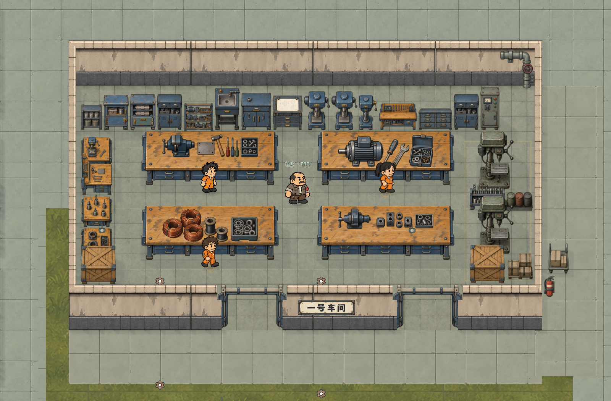

# 一号车间空间与摆件修订交付

一号车间已按修订需求接入最新保存地图。房间从 1360×720 收至 **1200×600**，面积减少约 **26.5%**；保留用户移动后的西北锚点 `[900,1080]`。南墙和东墙向内收缩，门、地面、屋顶与室内显隐范围跟随新边界，释放的地面作为外围工厂铺地。

此图由游戏直接渲染，仅在截图时隐藏 HUD 和信息图层，便于检查家具轮廓；完整信息图层的实机图为 `runtime-interior-v2.png`。人物、家具、地面和墙均为真实接入结果。

## 空间与摆件

| 部位 | 实际完成 |
| --- | --- |
| 主工作台 | 4 台两行两列；显示约 360×141.46，落地 360×90；重画更深的木台面和厚钢制抽屉 |
| 台面工序 | 钳工、电机、铜线圈、虎钳壳体四套附件；分别落在木台面范围，保留操作留白 |
| 北墙 | 15 个模块连续排列：罐桶架、三种高柜、开放零件柜、洗件台、双门工具柜、图纸柜、两台整体台钻、窄加工机、挂工具工位、抽屉柜、备件高柜和电控柜 |
| 西墙 | 4 段厚实工位，替换细长货架；末端为大斜撑木箱；模块独立注册和摆放 |
| 东墙 | 两台立式钻床，中间钻头夹具架和三只油桶，南端木箱；旧推车保留身份并移至东侧外围铺地区 |
| 北侧背墙 | 按用户指定恢复园区标准高墙，墙体显示高度为 120；北转角、灯、通风口和管线同步对齐 |
| 南侧入口 | 两处钢门及原关联门禁，工时关闭、午休开放；门口整身通行正常 |
| 人物与工作 | 保持 1.4 倍，三处工作站和监工巡行点更新，工资、工作时段、到岗规则保留 |

实际净地面纵深约为 500；南墙投影占用的约 100 单位单独处理。工作点、监工转向点和容器搜索站位均避开墙面及家具落地范围。

## 素材与接入

本次使用 **内置图像生成工具**制作并保留 **18 张原始透明 PNG**。高柜与西墙钻具的初版轮廓不符，已通过内置生成工具重新绘制；主工作台增加投影纵深，保留抽屉和腿的体量。所有最终 PNG 与生成源文件哈希一致，接入只设置有效区域、原比例显示尺寸和落地范围。

- 新图片与家具定义：`art/props/workshop_one_v2/`，包含 18 件新素材定义及校准复用的台面附件和机器。
- 墙体与北转角沿用 `art/architecture/workshop_one_v1/manifest.json` 的标准高度定义，原始 PNG 不改动。
- 完整提示词、来源与废弃版本记录：`generated-assets-v2.json`。
- 图片哈希、有效区域与显示尺寸：`asset-registration-v2.json`。
- 接入前后保存地图：`revision2-input-map.json`、`revision2-output-map.json`。
- 地图局部修改记录：`map-registration-v2.json`。
- 接入工具：`tools/register_workshop_two.py`；`--definitions-only` 更新资源定义，`--refine` 只校准本轮已接入的对象。

原容器 ID 和搜刮类型保留；新增罐桶架、图纸柜、西墙工位、东侧夹具架和木箱使用现有工具、工业零件和仓储搜刮规则。柜子内的物品仍支持放入背包和拖回来源容器。其他房间的家具、墙和显隐范围保持原数据。

## 验证与试玩

`qa/workshop_one_revision2.gd` 在原生窗口通过 **2419 项检查**，其中包含外围墙与表面逐项保护检查；功能检查覆盖标准北墙高度、两门双向整身通行、工作点和监工路线、实际巡行、所有搜索容器的可达站位、背包放入与放回、台面附件显示位置、门禁开关及屋顶显隐。结果见 `checks-v2.json`，日志见 `native-v2.log`。

地图编辑器回归 **20 项通过**，结果见 `editor-regression-v2.log`。新家具与沿用的标准墙体均在编辑器素材目录中。

试玩脚本为 `play-workshop-two.gd`，从车间内开始；靠近柜架按 E 搜索，两个门继续随工作时段开关。
