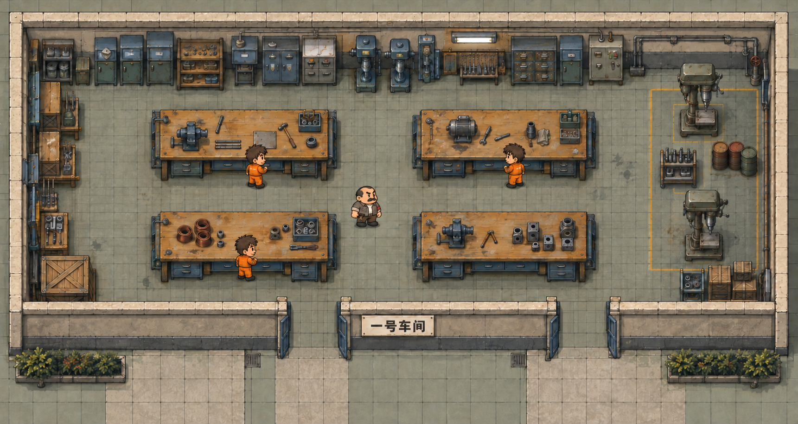
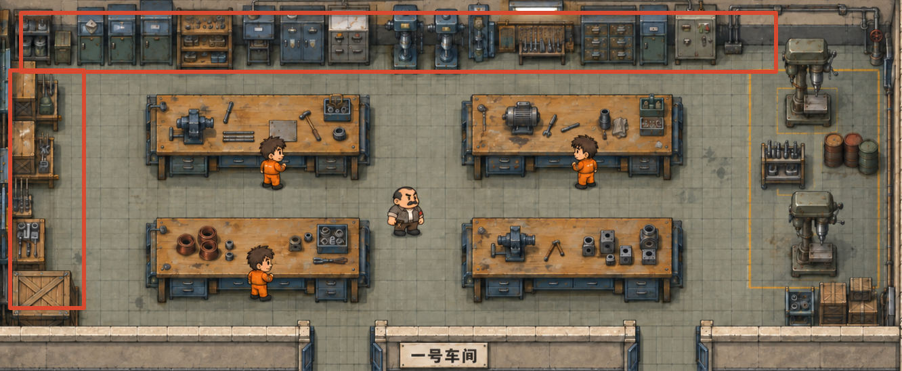
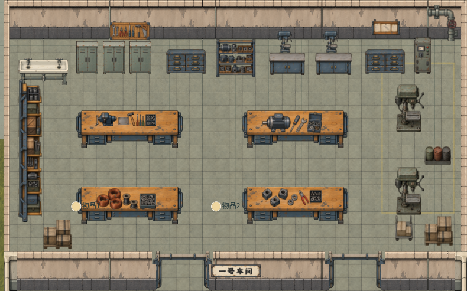

# 一号车间美术修订需求

一号车间要恢复参考图中紧凑、满载的装配车间。优先收紧房间纵深，重做北墙连续设备带和西墙工作模块，再统一工作台、机器与人物的比例。人物保持已经确定的 1.4 倍。此需求已执行，实际尺寸、接入结果和实机图见 [修订交付](delivery-v2.md)；以下保留制作目标与验收依据。

## 参考与上一版偏差

以本次完整概念图为整体目标，红框图为北墙和西墙的摆件依据，当前实机图用于对照差异。

| 部位 | 当前偏差 | 修订要求 |
| --- | --- | --- |
| 空间 | 保留 1360×720 的房间，工作台较薄，设备间的大片地面把车间拉空 | 房间宽度适度收缩，纵深优先收缩；扩大台体可见厚度，压缩沿墙间隔 |
| 北墙 | 三个普通工具柜、抽屉柜、两张低柜托细小台钻，形成稀疏的一排小家具 | 按参考重做约 15 个高低错落的设备模块，覆盖北墙可布置长度的 90% 左右 |
| 西墙 | 一张细窄的连续货架，隔层多而台面少 | 改为 3 段木面钢架工位和一段零件收纳模块，末端一个大木箱 |
| 工作台 | 台体尺寸 320×113.95，台面附件只集中在中间，桌前立面和抽屉偏薄 | 做厚实的四组台体，附件分布到整张桌面，有主设备、散件和操作留白 |
| 东墙 | 两台钻床之间只有油桶，缺少钻头夹具架；箱体和推车轮廓与参考不一致 | 补中间夹具架，底角按木箱和矮零件架组合重排；推车退出这一角的主体构图 |
| 风格 | 北墙白色洗手池和细长器械轮廓削弱重工业感 | 洗手池替换为参考中的小型工业操作台；机器和柜体增加清楚的钢制体量 |

上一版的通行和功能检查用于确认可玩性；视觉验收还需要同尺度、同镜头对照以上轮廓和密度。

## 房间与比例

第一轮试摆把室内标称范围从 **1360×720 收至约 1200×600**：宽度减少约 12%，纵深减少约 17%，面积减少约 26%。南墙可见墙身的投影也有碰撞，净可用地面须单独量取；按现有约 100 单位的南墙占用估算，净可用纵深约为 500。最终以真实墙体与角色整身通行校准。

保留四台两行两列、中央监工通道、东侧机器带和南侧双入口。先锁定家具与人物的相对尺度，再决定墙的收缩位置。建议西北角作为试摆锚点，南墙北移、东墙西移；共享墙和邻室布局先检查，受影响的走廊、门口铺地、屋顶和房间显隐范围同步调整。两处南门仍服务原通路，门位要跟随新房间和邻接走廊校准。

| 对象 | 首轮目标 | 验收关注点 |
| --- | --- | --- |
| 工人人物 | 保持 1.4 倍，参考身高约 87 单位 | 使用真实工人、监工共同试摆 |
| 主工作台 | 显示宽约 360，高约 135～150；落地深约 90～100 | 宽约为人物高度的 4 倍；台面、抽屉、桌腿都看得清 |
| 高柜和台钻 | 模块宽约 50～90，可见高度约 90～115 | 高柜、台钻形成连续上沿，低柜和工位穿插 |
| 西墙工位 | 显示横向厚度约 80～100 | 台面向室内展开，避免变成一条窄货架 |
| 中央主通道 | 净宽约 100～120 | 监工与工人可错身，路径不穿家具 |
| 工作台两排之间 | 落地边缘间距约 90～110 | 有完整站位；视觉投影与实际碰撞分别检查 |
| 东侧设备带 | 宽约 140～160 | 两台钻床、夹具架、油桶集中在旧黄线内 |
| 南侧通道 | 以角色碰撞体实测，约 60～80 净深起步 | 两个门口能从室内直接走出，桌前站位不落到墙体上 |

这些区间用于白盒摆放。若通行不够，先精简装饰占地和调整设备组合，再小幅放宽对应通道。家具图片保持原始比例；目标高度不符时重做源图，禁止把现有桌体纵向硬拉长。

## 北墙设备带

按参考图从左到右安排约 15 个模块。柜架之间留约 3～8 单位接缝；穿墙管线、工具板和灯是挂件，不重复占地。

| 顺序 | 模块与数量 | 必须画出的特征 | 制作处理 |
| --- | --- | --- | --- |
| 1 | 罐桶零件开放架 1 | 上层金属罐，下层桶件；粗钢架，有深度 | 新做北墙专用视角 |
| 2～4 | 蓝灰高工具柜 3 | 上方展示或开口格，下方锁柜；三种内容变化 | 替换当前普通铁皮柜，统一台体出三变体 |
| 5 | 木面零件开放柜 1 | 暖木格架，轴承、线圈和金属壳体 | 现有开放架先试摆，轮廓不足再重做 |
| 6 | 小型工业操作台 1 | 上方洗件盆或设备头，下方实体台柜 | 新做，替换大白洗手池 |
| 7 | 双门钢制工具柜 1 | 上部浅抽屉，两扇实体门和工具把手 | 新做 |
| 8 | 图纸抽屉工作柜 1 | 上部图纸或浅玻璃挡板，下部抽屉 | 新做；小文字只作装饰 |
| 9～10 | 台式钻加工单元 2 | 宽机头、粗立柱、钢制整体底座 | 重做完整单元，避免细钻头放在低柜上 |
| 11 | 窄立式加工设备 1 | 长立柱、侧把手、蓝灰机壳 | 新做 |
| 12 | 挂工具装配工位 1 | 背板长排扳手，木台面，下层格架 | 挂板可复用，台体新做并对齐 |
| 13 | 蓝灰抽屉零件柜 1 | 多排大抽屉、旧铜拉手 | 现有抽屉柜可复用，校准大小 |
| 14 | 窄高备件柜 1 | 上部检视格，下部长门 | 从新高工具柜派生 |
| 15 | 旧电控柜 1 | 厚实体柜，按钮、线管和警示小牌 | 现有素材试摆，补足体量 |

北墙柜体不能全部用同一铁柜重复代替。开放格、抽屉、柜门、机器立柱和挂工具台应在常用游戏缩放下仍然可分辨。管线从设备上方横向连接至东墙，减少零散的悬空挂件。

## 西墙工作模块

当前 `west-parts-rack.png` 退出这一段的主体布置。制作朝向东侧室内的专用纵向组合，按北至南排列：

1. 小型钻具木面工位：台面有小机器和夹具，下方钢柜。
2. 工具整理工位：台面散件、短工具背板，下层抽屉。
3. 钻头与圆筒件收纳模块：数件立起的金属件，下面深格架。
4. 重型金属件装配工位：大圆件和壳体，木面钢架轮廓厚实。
5. 西南大木箱：一只明显的斜撑板箱，宽度与工作模块相近。

前四段可共用两种底座，分别配台面附件；每段独立注册和摆放，接缝可调。木台面是这一侧的连续视觉线索，钢腿、抽屉和侧面都需要表现。台面朝室内，搜索点在东侧可达边缘，箱体不能顶住南门路线。

## 四组工作台和东侧设备

四组主工作台共用新的厚台体，配置四套附件。左上为虎钳、金属条和手锤；右上为电机、管件和扳手；左下为铜线圈、筒件及小托盘；右下为虎钳、壳体和圆形夹具。台面主体从左到右展开，小件穿插，约保留四分之一的操作面。磨损、刮痕和油渍分布在工作区附近，避免整面均匀噪点。

东侧保留两台立式钻床的大轮廓，重新校准可见体量。在两机之间补一张矮钻头夹具架和三只油桶。东南角用小型零件架加两组不同高度的木箱收尾；推车安排到走廊或其他库区。黄线围住机器操作区域，位置随设备重排，颜色褪旧，保持主通道通畅。

## 素材交付

优先制作北墙和西墙核心模块，其次主工作台，再补东侧附件。复用素材须在新比例中试摆后决定，数量以最终拆件表为准。

| 交付项 | 要求 |
| --- | --- |
| 视角 | 与概念图相同的俯视斜视投影；北墙、东墙、西墙朝向分别制作 |
| 材质 | 蜂蜜棕旧木、蓝灰厚钢柜、旧铜把手；小件保持清楚的亮暗面 |
| 文件 | 独立透明 PNG，按实际显示尺寸预留至少 2 倍清晰度；原图完整保留 |
| 拆分 | 台体与附件分开，高柜各变体分开，西墙模块分段；不烘焙人物 |
| 落地与排序 | 标注可见外框、真实落地范围和底部锚点；高柜立面不当作地面碰撞 |
| 门墙屋顶 | 房间缩小后重新组合墙与屋顶边界，两个门提供开关态，保持既有整身遮挡 |
| 清晰度 | 同一镜头检查台面和柜门细节；大轮廓优先，避免密集沙点代替材质 |

## 接入顺序与验收

1. 使用真实角色、两台钻床和四张台体白盒试摆约 1200×600 的室内范围。测量净可用地面，确认中央通道和两个出口。
2. 按北墙约 15 模块、西墙 4 工位加木箱的轮廓排满设备带，确定拆件表与各模块尺寸。
3. 制作新素材，在同一相机下检查与目标图的高低变化、厚度和设备密度。再接入完整小件和管线。
4. 从最新保存地图局部修改，保留容器身份与库存；更新房间地面、屋顶、显隐、墙体、门槛、工作点、监工路线及搜索站位。
5. 输出同一视野的室内实机与目标对照，并完成通行、劳动关门、午休开门、搜刮、背包拖回、门和高柜遮挡检查。

视觉验收须同时满足：四台占据中央主体；北墙几乎没有孤立大空隙；西墙有厚实工位而非细长货架；东侧存在夹具架与机器组；人物站入后房间仍显紧凑；门口和工位有实际可用空间。先以摆件类型、数量和轮廓确认还原程度，再检查材质细节。

本需求取代上一版保留 1360×720 房间和沿墙稀疏摆放的制作目标。原有交付与测试记录保留为上一版记录。
